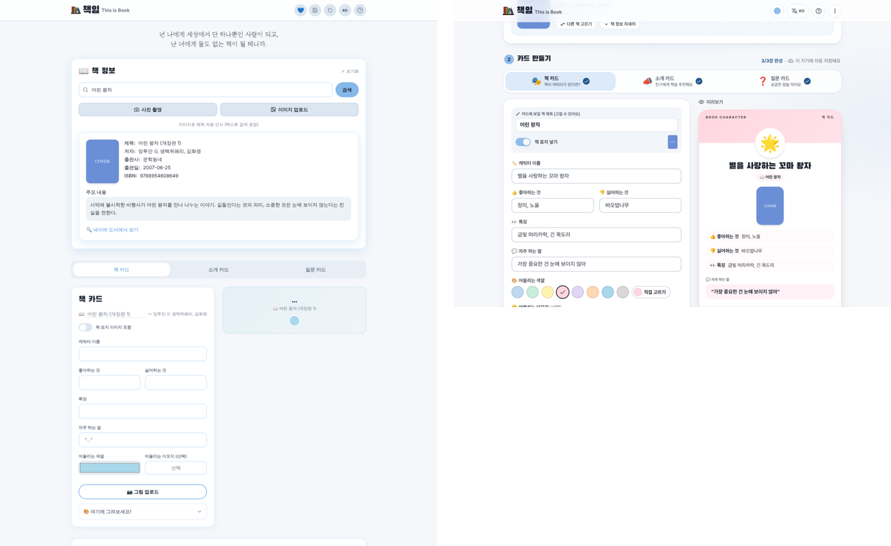
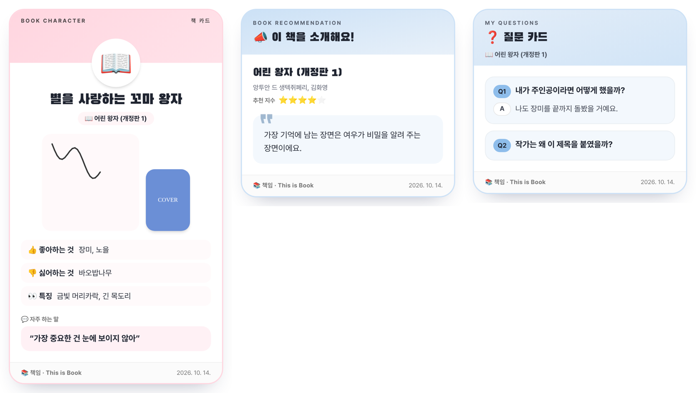
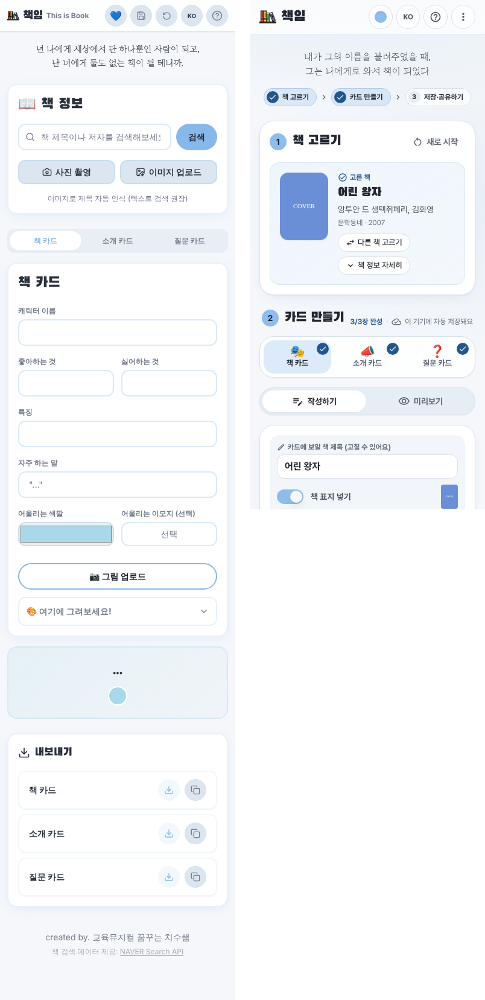

# 책임 · This is Book — UI/UX 진단 및 개선 보고서

작성일: 2026-10-14

## 1. 앱 구조 요약 (개선 전)

| 영역 | 구성 |
|---|---|
| 화면 | 단일 페이지(`pages/Index.tsx`): 헤더 → 인용 문구 → 책 검색 → 카드 탭 3종(작성 + 미리보기) → 내보내기 → 푸터 |
| 상태 | Zustand + localStorage 자동 저장(`lib/useAppStore.ts`) |
| 데이터 | 네이버 책 검색 API(Netlify Function 프록시), 표지 이미지 프록시, Tesseract OCR |
| 내보내기 | 화면 밖에 숨겨 둔 카드 복제본을 `html-to-image`로 PNG 변환 |
| 헤더 도구 | 테마(하트) · 데이터 저장/복원 · 초기화 · 언어 · 도움말 — 아이콘 5개 |

## 2. 진단 결과

### 2-1. 기능 결함 (버그)
| # | 문제 | 영향 |
|---|---|---|
| B1 | 그림판을 접었다 펴거나 새로고침하면 캔버스가 빈 상태로 보이고, 새로 그리면 **기존 그림이 덮어써짐** | 작업 손실 |
| B2 | 데이터 저장(JSON)에 **소개 이미지·카드용 책 제목·표지 표시 설정이 빠짐**, 불러오기 실패 시 아무 안내 없음 | 복원 불완전 |
| B3 | 업로드한 사진을 원본 그대로 localStorage에 저장 → 휴대폰 사진 1~2장이면 **용량(약 5MB) 초과로 자동 저장이 조용히 실패** | 작업 손실 |
| B4 | 질문 카드에 **질문 삭제 기능 없음** (기획서에는 추가/삭제 명시) | 기능 누락 |
| B5 | 이미지 저장·복사에 오류 처리 없음. Safari·Firefox에서 복사 실패 시 무반응 | 신뢰도 저하 |
| B6 | 미리보기 카드가 화면보다 길면 sticky 때문에 하단이 보이지 않음 | 확인 불가 |
| B7 | 책 카드 표지에 존재하지 않는 클래스(`h-34`) 사용 | 표지 비율 깨짐 |

### 2-2. 사용성(UX)
| # | 문제 |
|---|---|
| U1 | 모바일에서 작성 폼 아래로 한참 내려가야 미리보기가 보임 → 입력 결과를 바로 확인하기 어려움 |
| U2 | 카드를 저장하려면 페이지 맨 아래 '내보내기'까지 이동해야 함. 여러 장 일괄 저장(기획서의 체크박스 선택) 미구현 |
| U3 | 단계(책 고르기 → 카드 만들기 → 저장)가 화면에 드러나지 않고, 어떤 카드가 완성됐는지 알 수 없음 |
| U4 | 입력칸 글자 크기 14px → **iOS에서 입력칸을 누르면 화면이 확대**됨 |
| U5 | 책을 고른 뒤에도 긴 책 정보(10행 + 설명)가 항상 펼쳐져 있어 카드 영역이 멀리 밀려남 |
| U6 | 검색 결과에 표지·제목·저자만 있어 판본 구분이 어려움. 원하는 책이 검색되지 않으면 진행 불가 |
| U7 | 검색 영역 '초기화'와 헤더 '초기화'가 둘 다 내용을 지우는데 의미 구분이 없음 |
| U8 | 초등학생에게 빈 입력칸만 제시 — 무엇을 써야 할지에 대한 예시·글감 없음 |
| U9 | 헤더 아이콘 5개가 설명 없이 나열(하트=테마, 디스켓=저장 등) |

### 2-3. 시각 디자인 · 접근성
| # | 문제 |
|---|---|
| V1 | 파스텔 테마색을 그대로 글자색으로 사용(예: 활성 탭, 링크) → 흰 배경 대비 약 2:1로 **읽기 어려움** |
| V2 | 입력 패널에 마우스를 올리면 패널 전체가 떠오르는 애니메이션 → 입력 중 시선 흔들림 |
| V3 | 미리보기 카드가 단순한 색 상자 형태로, 저장했을 때 '작품' 느낌이 약함 |
| V4 | 모달이 직접 구현되어 Esc 닫기·포커스 이동이 안 됨, 토글 스위치가 `div` 클릭이라 키보드 조작 불가 |
| V5 | 초기화 모달·이모지 피커·이미지 버튼 등 **한국어 고정 문구 다수** → 다국어 전환 시 섞여 보임 |
| V6 | OG 메타태그가 'Lovable App' 기본값으로 남아 있어 링크 공유 시 앱 이름이 잘못 표시 |

## 3. 개선 계획과 반영 내용

### ① 흐름이 보이는 3단계 구조
- 상단에 **진행 단계 표시**(① 책 고르기 → ② 카드 만들기 → ③ 저장·공유하기), 단계별 완료 체크
- 카드 탭에 아이콘·한 줄 설명·**완성 배지**, "1/3장 완성 · 이 기기에 자동 저장돼요" 표시
- 각 카드 하단에 **"다음: 소개 카드 →"** 버튼으로 자연스럽게 다음 단계 안내

### ② 모바일 최적화
- 모바일에서 **[작성하기 | 미리보기] 전환 버튼**(화면 상단 고정) → 스크롤 없이 결과 확인
- 입력칸 16px로 상향(iOS 확대 방지), 버튼 높이 44px 이상(터치 영역), 한국어 단어 단위 줄바꿈
- 헤더를 **테마 · 언어 · 사용법 · 더보기(⋮)** 4개로 정리하고 각 버튼에 툴팁·라벨 제공

### ③ 저장·공유 강화
- **미리보기 바로 아래 [이미지 저장] [복사] [공유]** 버튼 (공유는 지원 기기에서만 표시)
- ③ 단계에서 **체크박스로 여러 장 골라 한 번에 저장**(완성된 카드는 기본 선택)
- 파일명 자동 지정: `책_카드_어린_왕자.png`
- 진행 중 표시, 실패·미지원 브라우저 안내 메시지, 웹폰트 포함 CSS 재사용으로 연속 저장 속도 개선

### ④ 아이들을 위한 글쓰기 도움
- 모든 입력칸에 **예시 문구**(예: "장미, 노을", "가장 중요한 건 눈에 보이지 않아")
- 소개 카드: **추천 지수(별 1~5개)**, 글머리 아이디어 버튼(“이 책을 한 문장으로 말하면…” 등), 글자 수 표시
- 질문 카드: **질문 아이디어 5종**(누르면 빈 칸에 채워짐), **질문 삭제**, Q1·Q2 번호 배지
- 책 카드: 치수쌤 파스텔 팔레트 기반 **색상 견본 8종 + 직접 고르기**, 이모지 60종

### ⑤ 책 고르기 개선
- 책을 고르면 **요약 카드**(표지·제목·저자·출판사·연도)로 접히고, '책 정보 자세히'로 펼침
- **다른 책 고르기**(작성 내용 유지)와 **새로 시작**(내용 삭제, 확인창) 역할 분리
- 검색 결과에 출판사·연도 추가, 표지 없을 때 대체 아이콘, 로딩 스켈레톤
- 검색되지 않는 책은 **직접 입력하기**(제목·지은이)로 진행 가능
- 각 카드 상단에서 카드에 표시될 책 제목 수정 + 표지 넣기 스위치(공통 컴포넌트)

### ⑥ 그림판 재설계
- 저장된 그림 **자동 복원**(새로고침·작업 파일 불러오기·초기화 모두 반영) — B1 해결
- **되돌리기(최대 20단계)**, 펜/지우개 전환, 색 10종, 굵기 미리보기, 스타일러스 필압 반영
- 내부 해상도 2배(600px)로 저장 이미지 선명도 향상, Pointer Events로 마우스·터치·펜 통합
- 캐릭터 그림을 **[사진·그림 올리기 | 직접 그리기]** 중 선택해 카드에 표시

### ⑦ 저장 카드 디자인 리뉴얼

- 책 카드: 캐릭터 색 띠 + 원형 이모지 아바타 + 정보 타일 + 말풍선 명대사
- 소개 카드: 표지·제목·별점 헤더 + 인용 부호 스타일 본문
- 질문 카드: Q/A 번호 배지, 빈 질문은 카드에서 제외
- 모든 카드 하단에 `📚 책임 · This is Book` 브랜드와 날짜 표기
- 색 띠 위 글자는 배경 밝기에 따라 검정/흰색 자동 선택

### ⑧ 디자인 시스템 · 접근성 (치수쌤 웹앱 표준 적용)
- **Pretendard GOV → Pretendard** 글꼴, **Google Material Icons(Outlined)** 아이콘으로 통일
- 표준 푸터(`auto_stories` 아이콘 + “Created by. 교육뮤지컬 꿈꾸는 치수쌤”) + NAVER API 출처
- 글자용 진한 테마색 토큰(`--primary-strong`) 추가로 대비 4.5:1 이상 확보 — V1 해결
- 모달·메뉴를 Radix(AlertDialog/Dialog/DropdownMenu/Switch/Checkbox)로 교체: Esc 닫기, 포커스 이동, 키보드 조작 지원
- 전 화면 포커스 링, `prefers-reduced-motion` 대응, 이미지·버튼 라벨(aria) 정리
- 하드코딩된 한국어 문구를 모두 `i18n.ts`로 이동(4개 언어), `<html lang>` 자동 변경
- 테마 이름 부여(하늘·새싹·햇살·꽃잎)와 색 견본 메뉴

### ⑨ 안정성
- 업로드 이미지를 **최대 1024px로 자동 축소** 후 저장 — B3 해결
- 저장 공간 초과 시 앱이 멈추지 않고 안내 메시지 표시
- 작업 파일 저장/불러오기에 모든 항목 포함, 이전 버전 파일·저장 데이터 자동 호환 — B2 해결
- OCR(Tesseract) 라이브러리를 필요할 때만 불러오도록 분리 → 첫 로딩 경량화
- OG 메타태그 정리, 사용하지 않는 Vite 템플릿 CSS 제거
- 단위 테스트 추가(i18n 치환, 진행도 판정, 파일명, 질문 추가/삭제, 이전 버전 파일 복원)

## 4. 검증
- `npm run build`, `tsc --noEmit`, `npm run lint`(오류 0), `npm test`(7개 통과)
- Playwright로 데스크톱(1280px)·모바일(390px)에서 **검색 → 책 선택 → 책/소개/질문 카드 작성 → 그림 그리기 → 카드 3종 PNG 저장 → 새로고침 후 복원**까지 자동 확인

## 5. 다음 단계 제안 (이번 범위 밖)
1. **학급 모드**: 교사가 여러 학생의 작업 파일을 모아 한 장의 인쇄용 PDF(A4 2~4장 배치)로 출력
2. **독서 기록장**: 완성한 책을 기기에 목록으로 쌓아 '내가 읽은 책' 책장 보기 제공
3. **카드 템플릿 선택**: 같은 내용에 2~3가지 카드 레이아웃(세로형/정사각형 SNS형) 제공
4. **Material Icons 자체 호스팅**: 학교망에서 Google Fonts가 막히는 경우를 대비해 아이콘 폰트를 앱에 포함
